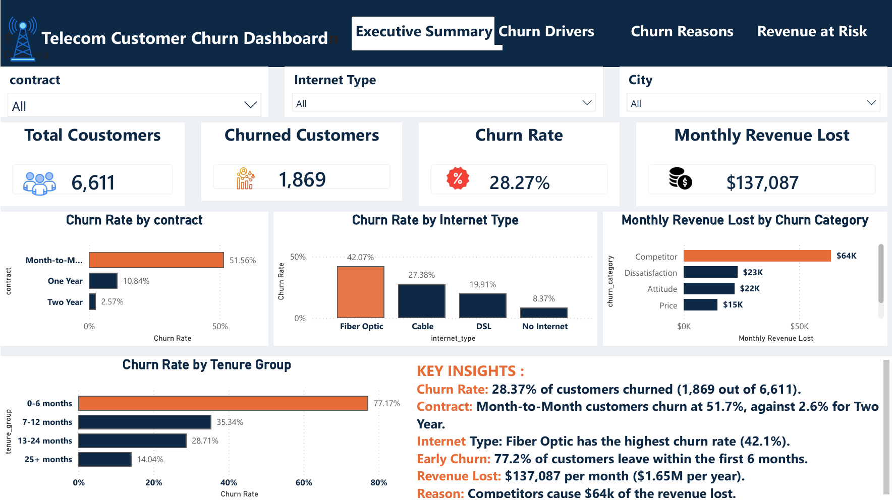
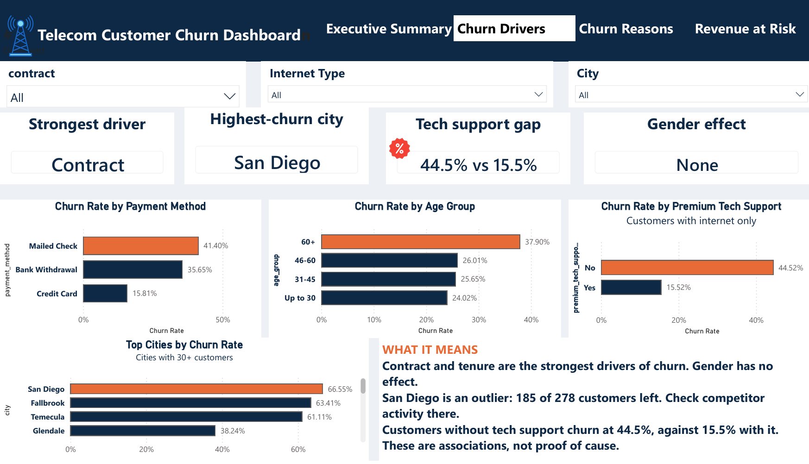
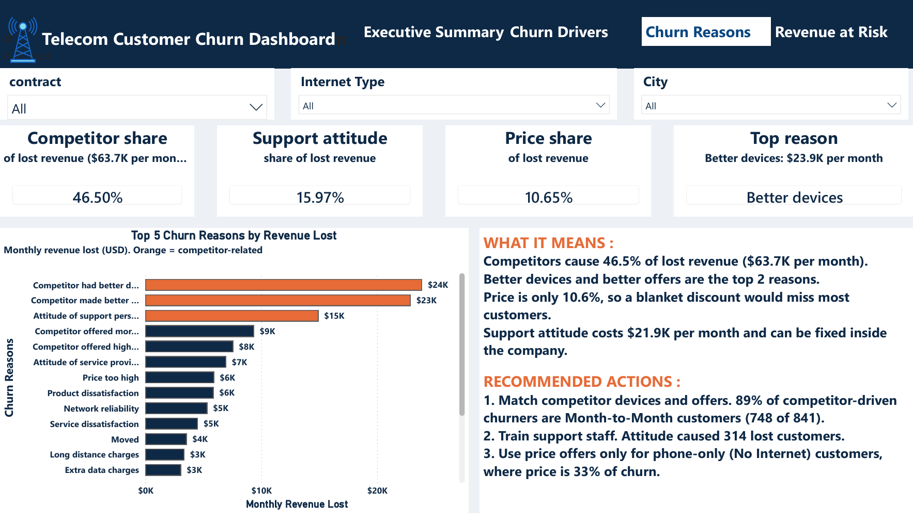
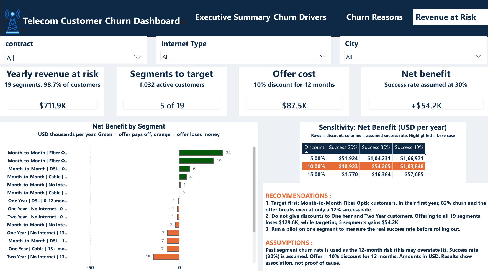

# Telecom Customer Churn and Revenue-at-Risk Analysis

I analysed a telecom customer dataset to answer one question: **who is leaving, why, and how much money is at risk?**

I used MySQL for the database and queries, Python for the statistics, and Power BI for the dashboard. I did not use machine learning on purpose. The goal was to explain churn and decide where a retention budget should go, not to build a prediction model.

---

## What I found

| Result | Value |
|---|---|
| Churn rate | 28.37% (1,869 of 6,589 customers) |
| Revenue lost to churn | 137,087 USD per month, about 1.65 million USD per year |
| Strongest link with churn | Contract type, then tenure |
| Riskiest group | Month-to-Month, Fiber Optic, first year: 753 customers, 81.7% churn |
| Main reason for leaving | Competitors, 46.5% of lost revenue. Price is only 10.6% |
| Retention offer (10% discount) | Targeting 5 of 19 segments: +54,205 USD. Offering to everyone: -129,631 USD |

In short: customers leave mostly because of competitors, not price. A blanket discount loses money. A targeted offer to new Month-to-Month Fiber customers is the part that holds up even when I stress-tested my assumptions.

---

## Dashboard

---

## How I did it

1. **Checked the data in Python.** No duplicate customer IDs, and the Total Revenue formula matched on all 7,043 rows. I removed 454 new ("Joined") customers because they have not had a chance to leave yet. That leaves 6,589 customers.
2. **Built a MySQL database with 5 tables** (locations, customers, services, billing, churn_status) with primary and foreign keys, and one view that joins everything.
3. **Answered 13 business questions in SQL** using joins, CASE, GROUP BY and HAVING.
4. **Tested the differences in Python.**
   - Chi-square tests with Cramer's V, to see which factors are linked with churn and how strongly. Gender was my control: it showed no link (p = 0.62).
   - Mann-Whitney tests for numbers like monthly charge, age and referrals.
   - Logistic regression for odds ratios, to see each factor with the others held constant.
5. **Estimated revenue at risk** by segment (contract, internet type, tenure) and simulated a 10% discount offer, with a sensitivity table and a stress test.
6. **Built a 4-page Power BI dashboard** with DAX measures.

---

## Files in this repository

| File | What it does |
|---|---|
| `01_create_tables.sql` | Creates the database and 5 tables |
| `02_create_view_churn_data.sql` | Creates the `churn_data` view (6,589 rows) |
| `03_validation_checks.sql` | Row counts and status checks |
| `04_business_queries.sql` | The 13 business queries |
| `01_data_quality_checks.ipynb` | Reads the CSV and checks data quality |
| `02_load_to_mysql.ipynb` | Splits the data into 5 tables and loads MySQL |
| `03_statistical_tests.ipynb` | Chi-square and Mann-Whitney tests |
| `04_logistic_regression.ipynb` | Odds ratios, VIF and model test |
| `06_revenue_at_risk_simulation.ipynb` | Segment simulation and sensitivity |
| `.pbix` file | The Power BI dashboard |
| `page1` to `page4` `.png` | Dashboard screenshots |

---

## How to run it

1. Download the dataset: **Telecom Customer Churn** from the Maven Analytics Data Playground (mavenanalytics.io/data-playground).
2. Save it as `telecom_customer_churn.csv` in a folder called `01_data/raw/` next to the notebooks.
3. Install the libraries: `pip install -r requirements.txt`
4. Run the SQL files in MySQL Workbench in this order: `01`, then run notebook `02` to load the data, then `02_create_view`, `03` and `04`.
5. In the notebooks, replace `YOUR_PASSWORD` with your own MySQL password.

---

## Limitations

- This is a public learning dataset, so the results describe this dataset, not a real company.
- Everything here is an **association, not a cause**. For example, customers with tech support churn less, but that does not prove tech support makes them stay.
- The money estimates depend on assumptions. The 30% offer success rate is my assumption, because the data has no information on it. Past churn rate is used as future risk, and my stress test shows this probably overstates the 12-month risk. A real pilot test is needed.
- Tenure is used in the logistic regression as a simple number. A survival model (such as Cox) would handle it more correctly. This is my next step.

---

## Tools

MySQL, MySQL Workbench, Python (Pandas, NumPy, SciPy, Statsmodels, Matplotlib, SQLAlchemy), Power BI, GitHub

## Contact

Ankit Jadhav
M.Sc. Statistics | Aspiring Data Analyst
LinkedIn: *add your link here*
Email: *add your email here*
